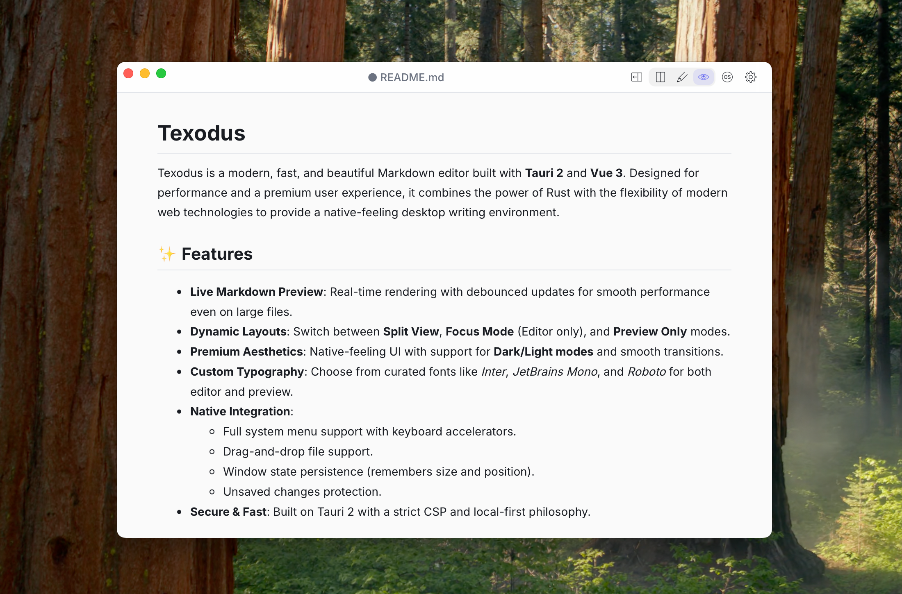
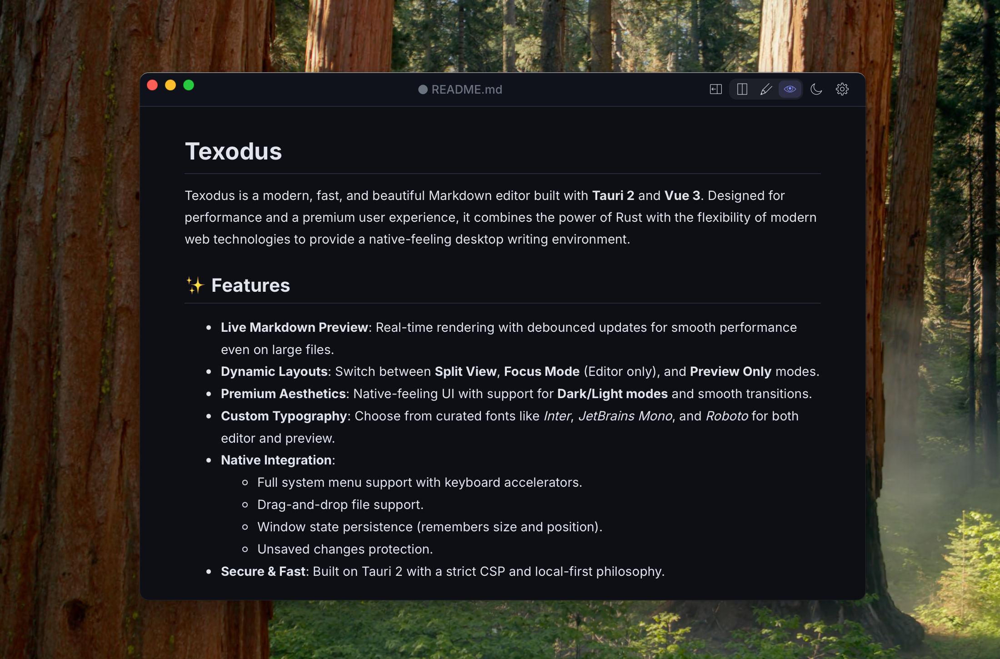

## What I added (using agents)

- TeX math in the live preview and in HTML/PDF exports.
- Standard LaTeX delimiters and environments: `$...$`, `$$...$$`, `\(...\)`, `\[...\]`, and `\begin{...}\end{...}`.
- Multi-line TeX, formulas split across lines, nested `$` inside `\text{...}`, and escaped `\$`.
- Correct TeX rendering in PDF exports.
- Find and replace merged into the existing find bar, with an empty replacement supported.
- Lazy KaTeX loading: documents without TeX do not load the math engine.

# Texodus

Texodus is a modern, fast, and beautiful Markdown editor built with **Tauri 2** and **Vue 3**. Designed for performance and a premium user experience, it combines the power of Rust with the flexibility of modern web technologies to provide a native-feeling desktop writing environment with robust support for the **GitHub Flavored Markdown (GFM)** standard.



## 📥 Installation

Download the latest release from the [releases page](https://github.com/w512/texodus/releases). It's available for **macOS**, **Windows**, and **Linux**. You can also build it from source.

## ✨ Features

-   **CodeMirror 6 Editor**: Modern editing experience with markdown syntax highlighting, smart indentation, and large-document performance.
-   **Live Markdown Preview**: Real-time, debounced rendering with full **GitHub Flavored Markdown (GFM)** support — tables, strikethrough, autolinks, and interactive task list checkboxes you can toggle directly in the preview.
-   **TeX Math**: Render inline `$...$` / `\(...\)` and display `$$...$$` / `\[...\]` / `\begin{equation}` (plus common LaTeX environments such as `align`, `gather`, `multline`, and `pmatrix`) with KaTeX in the live preview and HTML exports, and with MathJax vector SVG in PDF exports. Formulas may wrap across lines, a single `$` on its own line opens display math, and `$` inside `\text{…}` or `\$` is preserved. HTML output uses MathML, so exported pages stay self-contained with no stylesheet or font downloads.
-   **Mermaid Diagrams**: Render flowcharts, sequence diagrams, and other Mermaid graph types inline in the preview, themed to match the active color scheme.
-   **Local Images**: Embed images with relative (``) or absolute filesystem paths — resolved against the open document's directory via Tauri's asset protocol.
-   **Export**: Save the current document as standalone HTML or PDF.
-   **Workspace Sidebar**: Open a folder to browse its Markdown files in a lazy-loaded tree, with a context menu to create, rename, delete, and reveal files. Clicking a file opens it in the current window; `Cmd/Ctrl+Click` (or the context menu) opens it in a new window.
-   **Quick Open**: A `Cmd/Ctrl+P` palette to fuzzy-find and jump to any file in the workspace.
-   **Find & Replace**: A full-width find bar (`Cmd/Ctrl+F`, replace with `Cmd+Alt+F` / `Ctrl+H`) with live match counts, case-sensitive, whole-word, and regular-expression toggles, an explicit replace toggle, plus replace-current and replace-all. Search works in both the editor and the live preview; replace is enabled whenever the editor pane is mounted.
-   **Multi-Document & Multi-Window**: Open multiple documents in a new tabbed interface or separate native windows. A file that is already open elsewhere gets its window focused instead of being opened twice.
-   **Auto-Reload**: Files are automatically reloaded when they are changed on disk by external programs.
-   **Settings Mode**: A dedicated settings mode for easier configuration.
-   **Dynamic Layouts**: Switch between **Split View**, **Focus Mode** (editor only), and **Preview Only** modes.
-   **10 Color Schemes**: Default, Solarized, Nord, Monokai, Dracula, GitHub, Catppuccin, Gruvbox, Everforest, and Matrix — each with light and dark variants.
-   **Document Statistics**: Live word / character / line counts and reading-time estimates.
-   **Custom Typography**: Curated editor and preview fonts (JetBrains Mono, Iosevka, Inter, Roboto, Merriweather, …), all bundled locally — no network fonts.
-   **Native Integration**:
    -   Full system menu support with keyboard accelerators.
    -   Open Recent submenu in the File menu.
    -   Drag-and-drop file support.
    -   Window state persistence (remembers size, position, and maximized state).
    -   Unsaved changes protection.
-   **Secure & Fast**: Built on Tauri 2 with a strict CSP and a local-first philosophy — no telemetry, no cloud.

## 📸 Gallery

### Preview Only Mode (dark theme)


### Split View Mode


## 🛠️ Tech Stack

-   **Core**: [Tauri 2](https://v2.tauri.app/) (Rust)
-   **Frontend**: [Vue 3](https://vuejs.org/) (Composition API) + [Vite](https://vitejs.dev/)
-   **Editor**: [CodeMirror 6](https://codemirror.net/)
-   **State**: [Pinia](https://pinia.vuejs.org/)
-   **Markdown**: [marked.js](https://marked.js.org/) compliant with the **GitHub Flavored Markdown (GFM)** specification, with [DOMPurify](https://github.com/cure53/dompurify) for sanitization and [KaTeX](https://katex.org/) for TeX math.
-   **Diagrams**: [Mermaid](https://mermaid.js.org/)
-   **Syntax Highlighting**: [Prism.js](https://prismjs.com/) (preview code blocks)
-   **Styling**: Vanilla CSS (no frameworks) with CSS variables for theming.
-   **Package Manager**: [Bun](https://bun.sh/) (recommended)

## 🚀 Getting Started (for Developers)

#### Prerequisites

-   [Rust](https://www.rust-lang.org/tools/install) installed.
-   [Bun](https://bun.sh/) (preferred) or Node.js.
-   System-specific dependencies for Tauri (see [Tauri Prerequisites](https://v2.tauri.app/start/prerequisites/)).

#### Installation

1.  Clone the repository:
    ```bash
    git clone https://github.com/w512/texodus.git
    cd texodus
    ```

2.  Install dependencies:
    ```bash
    bun install
    ```

3.  Run the development server:
    ```bash
    bun run tauri dev
    ```

#### 📦 Building

To create a production-ready installer for your current platform:

```bash
bun run tauri build
```

Linux builds produce `.deb`, `.AppImage`, and `.rpm` packages; macOS produces `.dmg` and `.app`; Windows produces an NSIS installer.

> **Note (Linux/AppImage):** the release pipeline strips the bundled Wayland/DRM client libraries (`libwayland-*`, `libgbm`, `libdrm*`) from the AppImage after packaging so they resolve from the host — otherwise WebKitGTK's EGL init fails on recent Mesa (see the repack step in [`release.yml`](.github/workflows/release.yml)). A locally built AppImage does not get this treatment; if it aborts with `EGL_BAD_PARAMETER`, remove those libraries from the AppImage the same way.

## 🏗️ Project Structure

-   `src/`: Vue.js frontend source code.
    -   `assets/`: App icons and static assets.
    -   `components/`: Reusable Vue components.
    -   `composables/`: Shared logic (CodeMirror, native menus, formatting, scroll sync).
    -   `services/`: Core application services (file I/O, export, Mermaid, sanitization).
    -   `stores/`: Pinia state management (editor, settings, workspace).
    -   `themes/`: Color scheme definitions and Prism stylesheet.
    -   `utils/`: Path helpers and other small utilities.
-   `src-tauri/`: Rust backend and Tauri configuration.
-   `screenshots/`: Application screenshots for documentation.


## 📄 License

This project is licensed under the GNU General Public License v3 - see the [LICENSE](LICENSE.txt) file for details.
